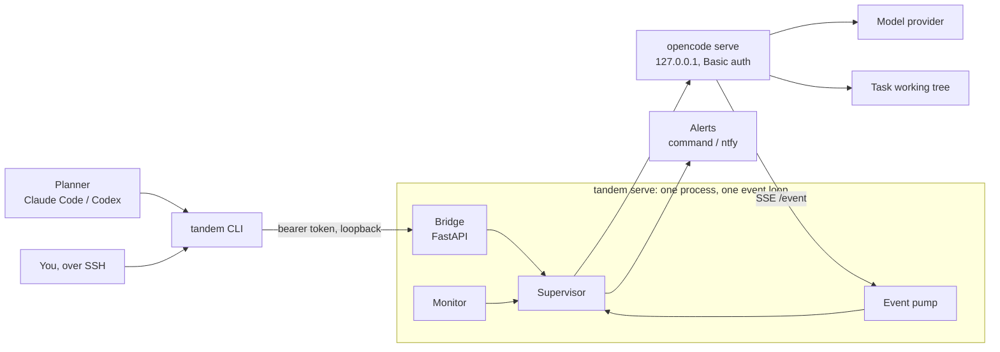
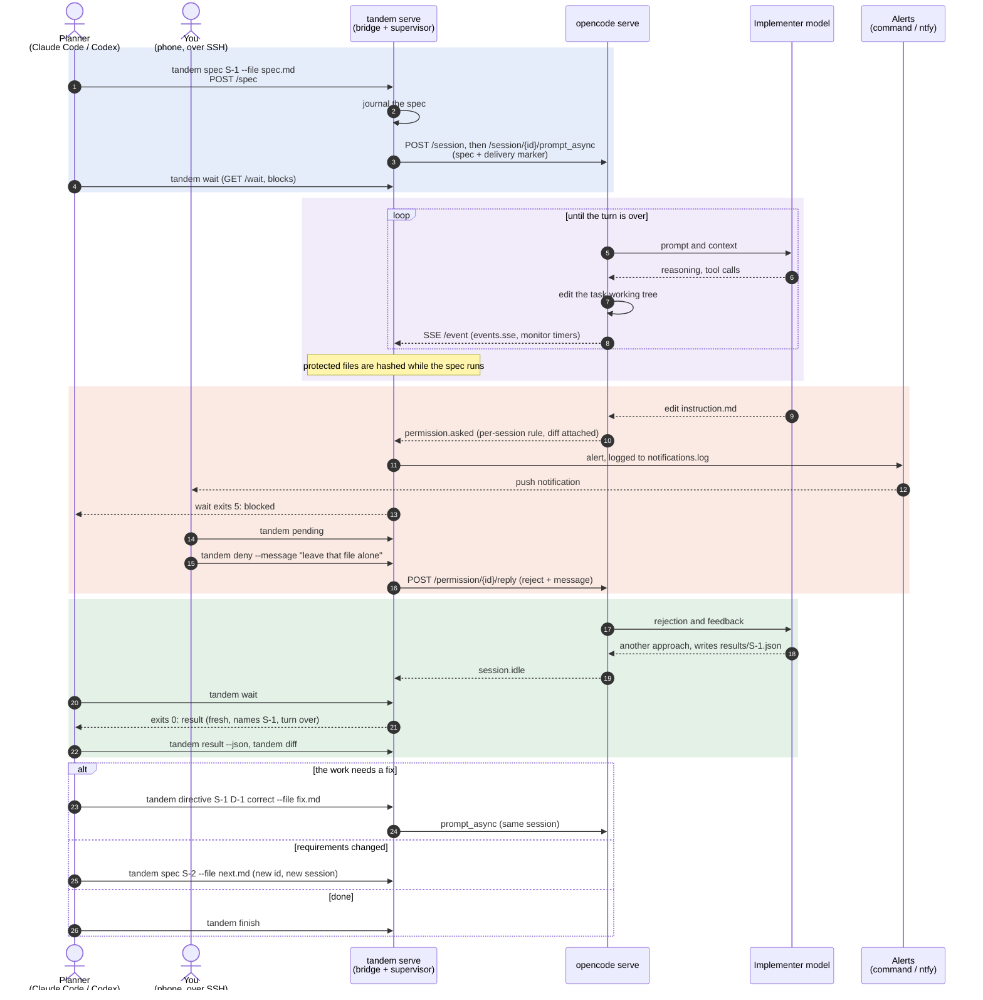

# tandem

A frontier model plans. A cheaper model, running in [OpenCode](https://opencode.ai), types.
tandem is the supervisor between them.

The planner (Claude Code, Codex, or you on a phone over SSH) submits a spec. tandem runs it in
a fresh headless OpenCode session, watches the event stream, pushes an alert when the
implementer is stuck waiting on a human, and tells the planner exactly why a turn stopped:
a result was written, a permission is pending, the model is reasoning in circles, or the
session has gone quiet.

<p align="center">
  
</p>

<details>
<summary>Static diagram</summary>



</details>

The planner and a human use the same client against the same bridge, so anything the
planner can do, you can do from a phone, and every call from either lands in one journal.

## A typical run

One spec end to end: the implementer tries to edit a protected file, you deny it from a
phone, it finishes, and the planner checks the work before moving on.



## Install

Python 3.12+ and [uv](https://docs.astral.sh/uv/). OpenCode **1.x**: OpenCode 2 replaced the
server API, and tandem refuses to start against it rather than failing with 404s.

```bash
npm i -g opencode-ai@1          # the 1.x line; tested against 1.19.3
uv tool install .               # puts `tandem` on PATH
```

Configure a provider in OpenCode as usual (`opencode auth login`). tandem uses your own
OpenCode config and adds per-session permission rules on top.

## Quickstart

```bash
tandem serve ~/work/my-task -m openrouter/qwen/qwen3-coder -p instruction.md
```

In another shell, or from the planner:

```bash
tandem spec S-1 --file spec.md     # fresh session, spec delivered
tandem wait                        # blocks until something needs you
tandem pending                     # what it is waiting on
tandem allow                       # or: tandem deny --message "leave that file alone"
tandem wait
tandem result                      # the implementer's own verdict
tandem diff                        # what it actually changed: check, don't trust
tandem directive S-1 D-1 correct "Use the existing retry helper."
tandem spec S-2 --file next.md     # requirements changed: new id, new session
tandem cost
tandem finish
```

With one supervisor running, no flags are needed to find it. With several, pass `--task`
with a name prefix, the task directory, or the state directory.

## The planner loop

`tandem wait` returns when the implementer needs the planner, and its exit code says why, so
a planner can branch without parsing anything:

| exit | reason | do this |
|---|---|---|
| 0 | `result` | review `tandem result --json`, then verify it yourself |
| 0 | `turn_ended` | the turn ended without a result; read `tandem msg 3` |
| 5 | `blocked` | `tandem pending`, then `allow`, `deny --message`, or `answer` |
| 8 | `reasoning_stall` | text, no tools, for 12 minutes: usually a contradiction in the spec |
| 4 | `hung` | nothing for 5 minutes, or one tool silent for 12 |
| 6 | `error` or `protected_violation` | provider error, or a protected file changed |
| 7 | `stopped` | the supervisor is shutting down |
| 124 | `timeout` | still working; wait again |

`wait` is level-triggered: it reports the current state, not the moment a state began, so a
planner that calls it in a loop cannot miss a wakeup. A result is reported once the turn is
over, not when the file lands, so the planner never reviews a moving target.

[`skills/tandem-planner/SKILL.md`](skills/tandem-planner/SKILL.md) is this loop written as an
Agent Skill for Claude Code or Codex.

## What it enforces

**A Spec ID is immutable and gets its own session.** Resubmitting the same id and text is a
no-op, so a retrying planner cannot duplicate work. The same id with different text is refused.

**A directive belongs to one spec.** A directive names its spec and is refused once that spec
is no longer active. In the file-based version of this harness, a leftover correction outlived
its spec and ended a later turn before the implementer had read its new instructions.

**Protected files are enforced twice.** A per-session permission rule stops an edit and waits
for a human with the diff attached. A content hash, checked while the spec runs, catches the
edits that arrive another way, such as a shell redirect. Either one aborts the session.

**A result has to be fresh.** The implementer writes JSON to a path given in its prompt. It
counts only if it names the active spec and was written after the latest prompt.

**Delivery is idempotent.** Every prompt carries a marker. After a restart, tandem adopts the
session it recorded and checks for the marker before sending anything again.

## Alerts

Permission requests, questions, provider errors, stalls and protected-file violations are
escalated. Finished turns are not: they are for the planner's `wait`, and a notification
nobody needed trains people to ignore the channel. Every alert is recorded in
`notifications.log`; delivery is opt-in:

```bash
tandem serve ... --notify-cmd 'notify-send "tandem" "$TANDEM_NOTIFY"'
tandem serve ... --ntfy-topic my-private-topic     # publishes summaries to ntfy.sh
```

The command gets `$TANDEM_NOTIFY`, `$TANDEM_KIND`, `$TANDEM_EVENT` (JSON) and `$TANDEM_TASK`,
and is killed if it runs longer than 30 seconds.

## Configuration

Every option of `tandem serve` can also come from the environment with a `TANDEM_` prefix:

| variable | default | |
|---|---|---|
| `TANDEM_MODEL` | OpenCode's default | `provider/model` for the implementer |
| `TANDEM_PROTECTED` | `[]` | JSON list of globs, e.g. `'["instruction.md","docs/*.md"]'` |
| `TANDEM_NOTIFY_CMD`, `TANDEM_NTFY_TOPIC` | off | alert delivery |
| `TANDEM_STALL_AFTER` | `720` | seconds of text without a tool call |
| `TANDEM_QUIET_AFTER` | `300` | seconds with neither |
| `TANDEM_STATE_ROOT` | `$XDG_STATE_HOME/tandem` | where task state lives |
| `TANDEM_OPENCODE_BIN` | `opencode` | the OpenCode binary |

## On disk

Everything about one task lives in one directory under the state root:

```
journal.jsonl        one line per state change: grep this first
state.json           resumable supervisor state
events.sse           the raw OpenCode event stream, oversized lines stubbed
notifications.log    every alert
manifest.json        bridge URL and token, 0600, removed on clean exit
results/<spec>.json  the implementer's results
sessions/<spec>/     final messages and totals per spec
opencode.log         the OpenCode server's own output
```

Files holding tokens, prompts or model output are created 0600.

## Development

```bash
uv sync
uv run ruff check && uv run ruff format --check
uv run pyright                    # strict
uv run pytest                     # unit tests, plus e2e when OpenCode 1.x is on PATH
```

The end-to-end tests run a real `opencode serve` against a scripted OpenAI-compatible model
in `tests/scripted_llm.py`. Only the model's choices are scripted; OpenCode's permission
system and event stream are the real thing. They cover a protected edit stopped and rejected,
a question answered, a correction applied, a second spec, a shell edit caught by the hash
guard, and a supervisor restart mid-spec.

## Design notes

- **One process, one event loop, one task group.** The bridge, the event pump and the monitor
  run under one `asyncio.TaskGroup`; if one dies the rest stop with it, and an exit stack
  stops OpenCode on the way out.
- **OpenCode runs as a separate process.** OpenCode's SDK can host it in-process, but a
  supervisor that shares a process with what it supervises cannot restart it when it wedges.
- **FastAPI only where there is a server.** The OpenCode client is httpx, the supervisor is
  plain asyncio, and the CLI is Typer over the same pydantic models the bridge serves.
- **`OpenCodeAPI` is a protocol.** The supervisor never sees HTTP, so the unit tests use an
  in-memory fake and an OpenCode 2 adapter would be one new class.
- **Plain files, not a database.** The planner reads the journal with `grep`.

## Limitations

- OpenCode 1.x only, for now.
- One active spec per task at a time, by design.
- `wait` reasons are heuristics over the event stream. The thresholds are configurable,
  and `tandem status` shows the numbers behind each call.
