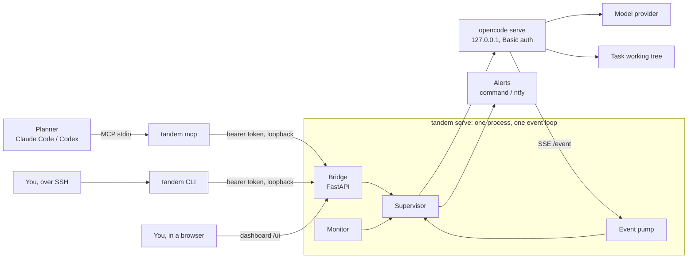
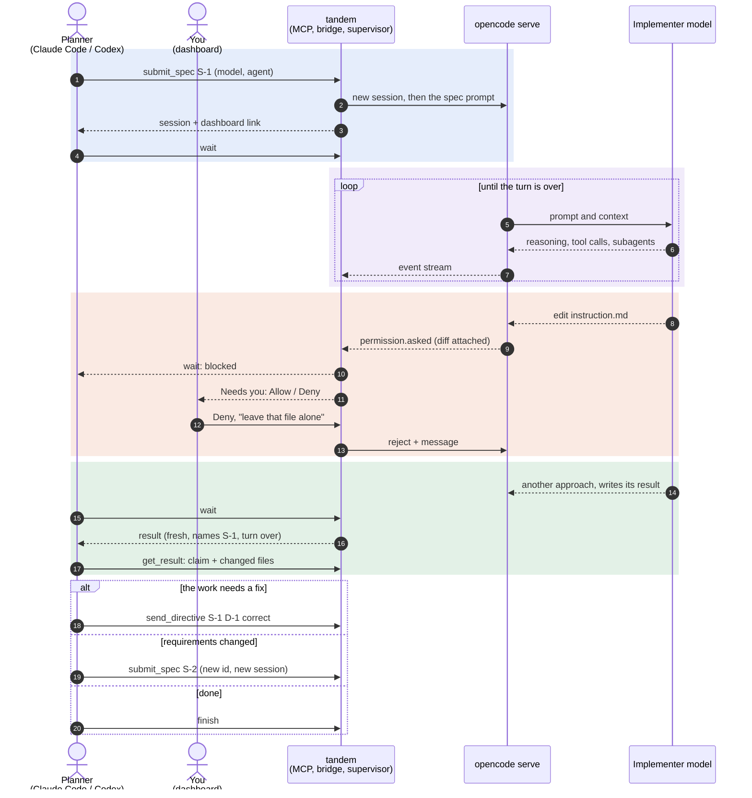

# tandem

A frontier model plans. A cheaper model, running in [OpenCode](https://opencode.ai), types.
tandem is the supervisor between them.

The planner (Claude Code or Codex, through tandem's MCP tools) submits a spec. tandem runs it
in a fresh headless OpenCode session with the model and agent the spec names, watches the
event stream, pushes an alert when the implementer is stuck waiting on a human, and tells the
planner exactly why a turn stopped: a result was written, a permission is pending, the model
is reasoning in circles, or the session has gone quiet. The human watches, and unblocks it,
from a dashboard in the browser.

<p align="center">
  
</p>

<details>
<summary>Static diagram</summary>



</details>

The planner and a human drive the same bridge, so anything the planner can do, you can do
from the dashboard or a phone, and every call from any of them lands in one journal.

## A typical run

One spec end to end: the implementer tries to edit a protected file, you deny it from the
dashboard, it finishes, and the planner checks the work before moving on.



## Install

Python 3.12+ and [uv](https://docs.astral.sh/uv/). OpenCode **1.x**: OpenCode 2 replaced the
server API, and tandem refuses to start against it rather than failing with 404s.

```bash
npm i -g opencode-ai@1          # the 1.x line; tested against 1.19.3
uv tool install .               # puts `tandem` on PATH
```

Configure a provider in OpenCode as usual (`opencode auth login`). tandem uses your own
OpenCode config and adds its protected-file rules on top.

## Use it from Claude Code or Codex

Register tandem once as an MCP server:

```bash
claude mcp add tandem --scope user -- tandem mcp      # Claude Code
codex mcp add tandem -- tandem mcp                    # Codex
```

That's all the setup there is. Ask the planner to delegate work, for example "have a cheaper
model write the tests for citations.py through tandem", and it uses the tools:
`submit_spec`, `wait`, `get_result`, `get_pending`, `reply_permission`, `send_directive`,
`finish`, and the rest. The server's instructions teach it the planner loop.

- **Nothing to start.** When the planner connects, `tandem mcp` starts one OpenCode server in
  the background, and the first `submit_spec` starts a supervisor for the planner's project.
  `start_implementer` is only for setting a default model or protected files.
- **Lives as long as the planner.** Everything runs in the `tandem mcp` process and its one
  OpenCode child. When the planner disconnects or exits, every supervisor finishes, capturing
  its evidence, and OpenCode stops. State stays on disk, so the next session resumes it.
- **Any implementer, per spec.** `submit_spec` takes `model` (`provider/model`) and `agent`
  (`build`, `plan`, or one from your OpenCode config). `list_models` shows what is available.
- **Subagents count.** When the implementer delegates to an OpenCode subagent, the subagent's
  permission requests block the spec and its activity keeps the spec alive. Protected files
  are enforced in its session too.
- **Several implementers at once.** For independent pieces of one task, the planner calls
  `spawn_implementer` once per piece. See below.

## Parallel implementers

Like a planner's own subagents, but each one is a cheaper model with its own guardrails:

```text
spawn_implementer(name="farewell", text=..., model="openai/gpt-5.6-luna")
spawn_implementer(name="subtract", text=..., model="openai/gpt-5.6-luna")
wait_any()                                   # wakes when either one needs the planner
land_implementer(name="farewell")            # review: the diff against where it forked
land_implementer(name="farewell", action="merge")
```

- **Isolated where it matters.** Each implementer works on its own branch, `tandem/<name>`, in
  a git worktree under the state root, outside the repository, with its own supervisor,
  journal and protected files. The planner's working tree stays clean.
- **One wait for all of them.** `wait_any` returns as soon as any implementer finishes, blocks
  or stops, and lists every one that needs attention. While it waits, it announces each
  change as an MCP progress message ("farewell finished S-1: result"), so the planner's UI
  shows an implementer ending as it happens.
- **Addressed by name.** Every other tool takes the implementer's name as `workdir`:
  `get_pending(workdir="farewell")`, `send_directive(..., workdir="farewell")`.
- **Landing is explicit.** `review` shows committed and uncommitted changes against the fork
  point. `merge` commits what the implementer left and merges it into the current branch, and
  a conflicting merge is aborted, leaving the repository untouched. `discard` throws the work
  away. Both stop the supervisor, remove the worktree and branch, and keep its state under
  `landed/` as evidence. Files left behind by running checks, such as `__pycache__`, are
  never committed.
- **Cheap to add.** Implementers share one process and one OpenCode server (see below), so a
  new one starts in a few seconds once the session's OpenCode is up.

## One process, one OpenCode

Under the MCP server, nothing sprawls. `tandem mcp` is the only tandem process:

- **One FastAPI app, one uvicorn.** Each implementer's bridge is mounted at `/t/<task>` in a
  single app, beside an overview page at `/ui` that lists every implementer. A task's manifest
  points at its mount, so the CLI and the tools reach it exactly as they reach a standalone one.
- **One OpenCode server.** Every implementer is a tenant of it, scoped to its own directory
  through OpenCode's `directory` parameter and reading its own events from the server-wide
  stream. It starts when the planner connects, so its startup is paid once per session.
- **Subagents stay guarded.** A server-wide config cannot know each implementer's protected
  files, so when a subagent's session appears, its supervisor patches that session to deny
  edits to them. The content hash still backs this up.
- **Nothing outlives the session.** On Linux the kernel stops OpenCode if `tandem mcp` dies
  without cleaning up; elsewhere, the next session stops any server its predecessor left.

`TANDEM_OPENCODE_MODE=isolated` restores one `tandem serve` process and one OpenCode per
implementer, each outliving the planner, for when one wedged server must not stall the rest.
Plain `tandem serve` from the CLI is always isolated.

## Watch it in a browser

Every tool reply carries a `dashboard` link, plus an `overview` link to the page that lists
every implementer of the session. `tandem serve` prints its dashboard link on startup. The page
shows what the implementer is doing and why `wait` would return right now, its latest
messages, the result and changed files, spend, and a timeline of everything in the journal.
Permission requests and questions appear with **Allow**/**Deny** and answer buttons, so the
human can unblock a run without a terminal. **Open in OpenCode** opens OpenCode's own web UI on
the same server. The access token travels in the link's `#fragment`, which browsers never send
to a server.

## The CLI: for humans and scripts

A planner should use the MCP tools. The CLI drives the same bridge, so it is for everything
else:

- **Stepping in from a terminal.** Over SSH from a phone, with no browser and no open port:
  see what is blocked, allow or deny it, and check on spend.
- **Scripts and CI.** Exit codes carry the reason (see [Exit codes](#exit-codes)), and
  `--json` gives the raw response, so a shell loop can drive an implementer with no planner.
- **Planners without MCP.** Anything that can run a shell command can use tandem.
- **A standalone supervisor.** `tandem serve` runs one task in its own process, outside any
  planner session.

Stepping in on a running implementer, whoever started it:

```bash
tandem status                      # what it is doing, and why `wait` would return now
tandem wait                        # blocks until something needs you
tandem pending                     # what it is waiting on
tandem allow                       # or: tandem deny --message "leave that file alone"
tandem log                         # the journal
tandem cost
```

Running a task without MCP, from a script or a planner that shells out:

```bash
tandem serve ~/work/my-task -m openrouter/qwen/qwen3-coder -p instruction.md
```

In another shell:

```bash
tandem spec S-1 --file spec.md     # fresh session, spec delivered (-m/--agent: per spec)
tandem wait                        # exit code says why it returned
tandem result                      # the implementer's own verdict
tandem diff                        # what it actually changed: check, don't trust
tandem directive S-1 D-1 correct "Use the existing retry helper."
tandem spec S-2 --file next.md     # requirements changed: new id, new session
tandem finish
```

These verbs mirror the MCP tools one for one: `spec` is `submit_spec`, `directive` is
`send_directive`, `allow`/`deny` are `reply_permission`, and so on.

To watch the implementer work, `tandem attach` opens OpenCode's own TUI on the live session,
and `tandem attach --web` prints a URL and login for OpenCode's web UI. Watch there, but steer
with `say` or `directive`: a prompt typed into OpenCode never reaches the journal.

With one supervisor running, no flags are needed to find it. With several, pass `--task`
with a name prefix, the task directory, or the state directory.

## Exit codes

`tandem wait` returns when the implementer needs attention, and its exit code says why, so a
script can branch without parsing anything. The MCP `wait` tool returns the same `reason`
with a `next_step`.

| exit | reason | do this |
|---|---|---|
| 0 | `result` | review `tandem result --json`, then verify it yourself |
| 0 | `turn_ended` | the turn ended without a result; read `tandem msg 3` |
| 5 | `blocked` | `tandem pending`, then `allow`, `deny --message`, or `answer` |
| 8 | `reasoning_stall` | text, no tools, for 12 minutes: usually a contradiction in the spec |
| 4 | `hung` | nothing for 5 minutes, or one tool silent for 12 |
| 6 | `error` or `protected_violation` | provider error, or a protected file changed |
| 7 | `stopped` | the supervisor is shutting down |
| 124 | `timeout` | still working; wait again |

`wait` is level-triggered: it reports the current state, not the moment a state began, so a
planner that calls it in a loop cannot miss a wakeup. A result is reported once the turn is
over, not when the file lands, so the planner never reviews a moving target.

[`skills/tandem-planner/SKILL.md`](skills/tandem-planner/SKILL.md) is the planner loop written
as an Agent Skill for Claude Code or Codex.

## What it enforces

**A Spec ID is immutable and gets its own session.** Resubmitting the same id and text is a
no-op, so a retrying planner cannot duplicate work. The same id with different text is refused.

**A directive belongs to one spec.** A directive names its spec and is refused once that spec
is no longer active. In the file-based version of this harness, a leftover correction outlived
its spec and ended a later turn before the implementer had read its new instructions.

**Protected files are enforced twice.** A permission rule stops an edit and waits for a human
with the diff attached. A content hash, checked while the spec runs, catches the edits that
arrive another way, such as a shell redirect. Either one aborts the session. The rule is set
both on the spec's session and in the config of the OpenCode server tandem starts, because a
subagent's session does not inherit the spec's rules.

**A restart keeps protection honest.** Each spec's baseline records the globs it was taken
under. Restarting with a different protect list checks the old files against the old baseline
first: intact, the spec moves to the new list; changed, the old list stays in force until the
files are restored.

**A result has to be fresh.** The implementer writes JSON to a path given in its prompt. It
counts only if it names the active spec and was written after the latest prompt.

**Delivery is idempotent.** Every prompt carries a marker. After a restart, tandem adopts the
session it recorded and checks for the marker before sending anything again.

## Alerts

Permission requests, questions, provider errors, stalls and protected-file violations are
escalated. Finished turns are not: they are for the planner's `wait`, and a notification
nobody needed trains people to ignore the channel. Every alert is recorded in
`notifications.log`; delivery is opt-in:

```bash
tandem serve ... --notify-cmd 'notify-send "tandem" "$TANDEM_NOTIFY"'
tandem serve ... --ntfy-topic my-private-topic     # publishes summaries to ntfy.sh
```

The command gets `$TANDEM_NOTIFY`, `$TANDEM_KIND`, `$TANDEM_EVENT` (JSON) and `$TANDEM_TASK`,
and is killed if it runs longer than 30 seconds.

## Configuration

Every option of `tandem serve` can also come from the environment with a `TANDEM_` prefix:

| variable | default | |
|---|---|---|
| `TANDEM_MODEL` | OpenCode's default | `provider/model` for the implementer |
| `TANDEM_PROTECTED` | `[]` | JSON list of globs, e.g. `'["instruction.md","docs/*.md"]'` |
| `TANDEM_NOTIFY_CMD`, `TANDEM_NTFY_TOPIC` | off | alert delivery |
| `TANDEM_STALL_AFTER` | `720` | seconds of text without a tool call |
| `TANDEM_QUIET_AFTER` | `300` | seconds with neither |
| `TANDEM_STATE_ROOT` | `$XDG_STATE_HOME/tandem` | where task state lives |
| `TANDEM_OPENCODE_BIN` | `opencode` | the OpenCode binary |
| `TANDEM_WORKDIR` | the MCP server's working directory | the project `tandem mcp` acts on by default |
| `TANDEM_OPENCODE_MODE` | `shared` | `isolated`: one process and OpenCode per implementer |

## On disk

Everything about one task lives in one directory under the state root:

```
journal.jsonl        one line per state change: grep this first
state.json           resumable supervisor state
events.sse           the raw OpenCode event stream, oversized lines stubbed
notifications.log    every alert
manifest.json        bridge URL and token, OpenCode login, 0600, removed on clean exit
results/<spec>.json  the implementer's results
sessions/<spec>/     final messages and totals per spec
opencode.log         the OpenCode server's own output
serve.log            the supervisor's own output, when started in isolated mode
```

Beside the tasks, `hosts/` holds the shared OpenCode server's log and a record of it, which is
how a later session finds a server orphaned by a crash. `worktrees/` holds parallel
implementers' worktrees, and `landed/` the state of implementers that were merged or discarded.

Files holding tokens, prompts or model output are created 0600.

## Development

```bash
uv sync
uv run ruff check && uv run ruff format --check
uv run pyright                    # strict
uv run pytest                     # unit tests, plus e2e when OpenCode 1.x is on PATH
```

The end-to-end tests run a real `opencode serve` against a scripted OpenAI-compatible model
in `tests/scripted_llm.py`. Only the model's choices are scripted; OpenCode's permission
system and event stream are the real thing. They cover a protected edit stopped and rejected,
a question answered, a correction applied, a second spec, a shell edit caught by the hash
guard, and a supervisor restart mid-spec. The MCP tools are tested against a mocked bridge in
`tests/test_mcp.py`, and implementer worktrees against a real git repository in
`tests/test_worktrees.py`.

## Design notes

- **One process, one event loop, one task group.** The bridge, the event pump and the monitor
  run under one `asyncio.TaskGroup`; if one dies the rest stop with it, and an exit stack
  stops OpenCode on the way out.
- **OpenCode runs as a separate process.** OpenCode's SDK can host it in-process, but a
  supervisor that shares a process with what it supervises cannot restart it when it wedges.
  Under the MCP server, one OpenCode is shared, and replaced if it dies.
- **A task is not a server.** `open_task` builds a supervisor and its bridge app with no server
  of its own, so the same task runs behind `tandem serve`'s uvicorn or mounted in the hub's.
- **FastAPI only where there is a server.** The OpenCode client is httpx, the supervisor is
  plain asyncio, and the CLI is Typer over the same pydantic models the bridge serves.
- **`OpenCodeAPI` is a protocol.** The supervisor never sees HTTP, so the unit tests use an
  in-memory fake and an OpenCode 2 adapter would be one new class.
- **Plain files, not a database.** The planner reads the journal with `grep`.
- **Git is the registry.** Parallel implementers are found from `git worktree list`, so there
  is no second record of them that could disagree with the repository.
- **The MCP server is a thin client.** `tandem mcp` holds no state: it finds a supervisor by
  directory, starts one detached if there is none, and calls the same bridge endpoints as the
  CLI. Restarting the planner loses nothing.
- **The CLI came first.** Any agent can run a shell command, so tandem began as a CLI a
  planner shelled out to, with exit codes as its interface. Structured tools suited planners
  better, so MCP took over that role; the CLI stayed because a human in a terminal, and a
  script in CI, still need a way in.
- **The dashboard is one static page.** It holds no data and needs no build step. It reads its
  token from the URL fragment and polls the same authenticated endpoints as everyone else.

## Limitations

- OpenCode 1.x only, for now.
- One active spec per task at a time, by design. Parallel work means one worktree each.
- `list_models` shows what OpenCode lists, not what an account accepts: a ChatGPT login
  refuses some OpenAI models, and that surfaces as `error` from `wait`.
- `wait` reasons are heuristics over the event stream. The thresholds are configurable,
  and `tandem status` shows the numbers behind each call.
